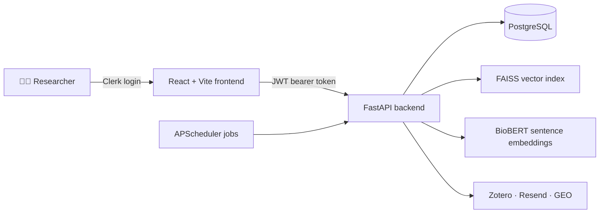

<div align="center">

# 📚 Daily Academic

**Your personalized daily feed of scientific research.**

Daily Academic matches new papers from thousands of journals — plus bioRxiv & medRxiv preprints —
to *your* research interests using AI-powered semantic search.

[](LICENSE)
[](https://www.python.org/)
[](https://fastapi.tiangolo.com/)
[](https://react.dev/)
[](https://www.typescriptlang.org/)
[](https://vite.dev/)
[](https://www.postgresql.org/)
[](https://github.com/facebookresearch/faiss)
[](https://clerk.com/)

[](https://www.daily-academic.com)
[](https://doi.org/10.64898/2026.11.19.767813)
[](https://status.daily-academic.com)
[](https://github.com/DimitrisGrig/academic.daily.app/issues)
[](#-contributing)
[](https://paypal.me/dailyacademic)

[**Try it →**](https://app.daily-academic.com) &nbsp;·&nbsp;
[Report a bug](https://github.com/DimitrisGrig/academic.daily.app/issues/new?template=bug_report.md) &nbsp;·&nbsp;
[Request a feature](https://github.com/DimitrisGrig/academic.daily.app/issues/new?template=feature_request.md) &nbsp;·&nbsp;
[Support the project 💜](#-support-the-project)

</div>

---

## 📖 Table of contents

- [What is Daily Academic?](#-what-is-daily-academic)
- [Features](#-features)
- [How it works](#-how-it-works)
- [Tech stack](#-tech-stack)
- [Project structure](#-project-structure)
- [Getting started](#-getting-started)
- [Configuration](#%EF%B8%8F-configuration)
- [Deployment](#-deployment)
- [Bug reports & feature requests](#-bug-reports--feature-requests)
- [Contributing](#-contributing)
- [Support the project](#-support-the-project)
- [Security](#-security)
- [Contact](#-contact)
- [Citation](#-citation)
- [License](#-license)

---

## 💡 What is Daily Academic?

Keeping up with the literature is hard. Daily Academic turns the firehose of new publications into a short,
relevant daily reading list.

Describe what you study in a sentence or two — e.g. *"I study mRNA splicing mechanisms in neurodegeneration
and follow advances in CRISPR-based therapeutic approaches"* — optionally link your Google Scholar profile,
and your **Main Feed** fills with the papers most relevant to you, ranked by semantic similarity.
The feed keeps learning as you upvote, read and bookmark.

## ✨ Features

| | Feature | Description |
|---|---|---|
| 🧠 | **Personalized main feed** | Papers from PubMed and major journals, ranked by semantic similarity to your research profile. Improves as you interact. |
| 🎯 | **Custom feeds** | Focused reading lists defined in plain language, filtered by journal, publisher, publication type, time range, open access or graphical abstract. |
| 📰 | **Journal follows** | Track every new article from a specific journal. |
| 🧬 | **BioArchive** | AI-ranked bioRxiv & medRxiv preprints, separate from peer-reviewed content. |
| 🔖 | **Bookmarks** | Save papers into named folders — perfect for journal clubs, grants and reviews. |
| 👥 | **Research groups** | Share articles with your team and discuss them in per-article comment threads. |
| 🏷️ | **Topics & tags** | Every paper is tagged from a curated taxonomy; browse trending and popular topics. |
| 🔎 | **Search** | Global semantic search across articles, journals and preprints. |
| 🕘 | **History & metrics** | A searchable archive of what you've read, plus weekly reading stats. |
| 📤 | **Zotero integration** | One-click export of any article to your Zotero library (OAuth). |
| 📧 | **Email digests** | A weekly digest of relevant papers you haven't seen yet — one-click unsubscribe. |
| 🔔 | **Notifications** | In-app alerts for group activity, replies and announcements. |

## ⚙️ How it works



1. **Embeddings** — article abstracts and user interest profiles are embedded with a biomedical sentence-transformer
   ([`pritamdeka/BioBERT-mnli-snli-scinli-scitail-mednli-stsb`](https://huggingface.co/pritamdeka/BioBERT-mnli-snli-scinli-scitail-mednli-stsb)).
2. **Retrieval** — a [FAISS](https://github.com/facebookresearch/faiss) index finds the articles closest to each profile or custom feed.
3. **Feedback loop** — upvotes, reads and bookmarks refine each user's profile embedding (refreshed nightly).
4. **Background jobs** — APScheduler keeps embeddings, MeSH terms and Clerk users in sync and sends the weekly digest
   (protected by PostgreSQL advisory locks so multiple workers never run a job twice).

## 🧰 Tech stack

| Layer | Technologies |
|---|---|
| **Frontend** | React 19, TypeScript, Vite, Ant Design, Tailwind CSS, TanStack Query, React Router, Recharts |
| **Backend** | Python 3.12, FastAPI, SQLAlchemy, Gunicorn/Uvicorn, APScheduler, SlowAPI (rate limiting) |
| **AI / search** | sentence-transformers, PyTorch, FAISS, BM25 (benchmarking) |
| **Data** | PostgreSQL + pgvector |
| **Auth** | Clerk (JWT verified against Clerk JWKS), Svix-signed webhooks |
| **Integrations** | Zotero OAuth, Resend (email), Google Analytics |
| **Infra** | Nginx (reverse proxy + TLS via Let's Encrypt), systemd |

## 🗂 Project structure

```
academic.daily.app/
├── backend/                  # FastAPI application
│   ├── main.py               # App entry point, middleware & router registration
│   ├── auth.py               # Clerk JWT verification & admin guard
│   ├── models.py             # SQLAlchemy models
│   ├── routers/              # API endpoints (feeds, groups, search, digests, zotero, admin…)
│   ├── crud/                 # Database access helpers
│   ├── vector_store/         # FAISS index management
│   ├── migrations/           # One-off schema migrations
│   ├── gunicorn_config.py    # Production server config
│   └── .env.example          # Backend configuration template
├── frontend/                 # React + Vite single-page app
│   ├── src/pages/            # Main feed, explore, groups, settings, admin…
│   ├── src/components/       # UI components
│   ├── src/lib/              # Axios client (auto-attaches Clerk token), API helpers
│   └── .env.example          # Frontend configuration template
├── docs/                     # Architecture, deployment & feature guides
├── nginx.conf                # Example Nginx site config
├── academic-daily-backend.service  # Example systemd unit
└── deploy.sh                 # Server setup script
```

## 🚀 Getting started

### Prerequisites

- **Python** 3.12
- **Node.js** 20 LTS
- **PostgreSQL** 14+ with the [`pgvector`](https://github.com/pgvector/pgvector) extension
- A **[Clerk](https://clerk.com)** application (free tier is fine)
- ~4 GB RAM for the embedding model and FAISS index

### 1. Clone

```bash
git clone https://github.com/DimitrisGrig/academic.daily.app.git
cd academic.daily.app
```

### 2. Backend

```bash
cd backend
python3 -m venv venv
source venv/bin/activate          # Windows: venv\Scripts\activate
pip install -r requirements.txt

cp .env.example .env              # then fill in your values (see Configuration)
uvicorn main:app --reload --port 8013
```

API docs are now available at <http://localhost:8013/docs>.

> **Tip:** always start the backend from the activated `venv` — running a system-wide `uvicorn`
> will fail with `ModuleNotFoundError`.

### 3. Frontend

```bash
cd frontend
npm install

cp .env.example .env.development  # then fill in your values
npm run dev
```

Open <http://localhost:5173> and sign in.

## 🛠️ Configuration

All configuration lives in environment files that are **never committed**. Copy the templates and fill them in:

| File | Template | Purpose |
|---|---|---|
| `backend/.env` | [`backend/.env.example`](backend/.env.example) | Database, Clerk secret, Resend, Zotero, GEO, admin settings |
| `frontend/.env.development` / `.env.production` | [`frontend/.env.example`](frontend/.env.example) | API URL, Clerk publishable key, analytics |

<details>
<summary><b>Backend variables</b></summary>

| Variable | Required | Description |
|---|:---:|---|
| `db_host`, `db_port`, `db_name`, `db_user`, `db_password` | ✅ | PostgreSQL connection |
| `CLERK_PUBLISHABLE_KEY`, `CLERK_SECRET_KEY` | ✅ | Clerk API keys |
| `CLERK_WEBHOOK_SECRET` | ✅ in prod | Verifies Clerk webhooks (Svix) |
| `ADMIN_CLERK_USER_ID` | ✅ | Clerk user ID allowed to use admin endpoints |
| `ADMIN_SECRET_KEY` | ✅ | Secret for `X-Admin-Secret` maintenance endpoints |
| `FAISS_INDEX_DIR`, `FAISS_INDEX_BIOARCHIVE_DIR` | ✅ | Where the FAISS indexes are stored |
| `RESEND_API_KEY`, `DIGEST_FROM`, `FRONTEND_URL` | for digests | Weekly email digest |
| `ZOTERO_CLIENT_KEY`, `ZOTERO_CLIENT_SECRET` | for Zotero | Zotero OAuth app credentials |
| `GEO_API_BASE_URL`, `GEO_API_USERNAME`, `GEO_API_PASSWORD` | optional | GEO dataset lookups (server-side only) |
| `BLOCKED_CLERK_USER_IDS` | optional | Comma-separated users to block |
| `DIGEST_ALWAYS_SEND_TO` | optional | Emails that always receive the digest |
| `ENABLE_DIGEST_PREVIEW` | optional | `true` enables `/mail-digests/preview` — **keep off in production** |

</details>

<details>
<summary><b>Frontend variables</b></summary>

| Variable | Description |
|---|---|
| `VITE_API_URL` | Backend URL (`http://localhost:8013` in dev, `/api` behind Nginx) |
| `VITE_CLERK_PUBLISHABLE_KEY` | Clerk publishable key (`pk_test_…` / `pk_live_…`) |
| `VITE_GA_MEASUREMENT_ID` | Google Analytics ID (optional) |
| `VITE_ADMIN_CLERK_USER_ID` | Shows the admin UI for this user |
| `VITE_BLOCKED_CLERK_USER_IDS` | Comma-separated blocked users |

> ⚠️ Every `VITE_*` value is compiled into the public JavaScript bundle. **Never put secrets in the frontend env files.**

</details>

## 🌍 Deployment

The production setup runs **Gunicorn + Uvicorn workers** behind **Nginx**, managed by **systemd**:

```bash
sudo ./deploy.sh                              # installs Nginx/Node, builds the frontend
sudo cp academic-daily-backend.service /etc/systemd/system/
sudo systemctl enable --now academic-daily-backend
```

See [`docs/DEPLOYMENT_GUIDE.md`](docs/DEPLOYMENT_GUIDE.md) for TLS, Nginx and monitoring details.

## 🐞 Bug reports & feature requests

Issues and feature requests live **right here** in this repository. 🙌

### Reporting a bug

[**Open a bug report →**](https://github.com/DimitrisGrig/academic.daily.app/issues/new?template=bug_report.md)

Please include:
- A clear and concise description of the issue
- Steps to reproduce the behavior
- Expected vs. actual behavior
- Screenshots or logs (if applicable)
- Browser / OS information

### Requesting a feature

[**Open a feature request →**](https://github.com/DimitrisGrig/academic.daily.app/issues/new?template=feature_request.md)

Try to include:
- The problem you're trying to solve
- Your proposed solution or idea
- Why this feature would be useful
- Any relevant examples or references

> Please **don't** use issues for account problems or private support requests — email
> [support@daily-academic.com](mailto:support@daily-academic.com) instead.

### 📡 Service status

Is Daily Academic down? Check real-time uptime, incidents and maintenance at
**[status.daily-academic.com](https://status.daily-academic.com)** (powered by Better Stack).

## 🤝 Contributing

Contributions are welcome!

1. Fork the repository and create a branch: `git checkout -b feature/my-improvement`
2. Make your changes — keep them focused and match the surrounding code style
3. Make sure the frontend builds (`npm run build`) and the backend starts
4. Open a pull request describing **what** changed and **why**

For larger changes, please open a [feature request](https://github.com/DimitrisGrig/academic.daily.app/issues/new?template=feature_request.md)
first so we can discuss the approach.

## 💜 Support the project

Daily Academic is free to use and open source. Running it isn't free, though — servers, the AI models
behind the recommendations, the database and email delivery all cost money every month.

If Daily Academic saves you time keeping up with the literature, please consider supporting it:

<p align="center">
  <a href="https://paypal.me/dailyacademic">
    
  </a>
</p>

Every contribution, however small, helps keep the platform running and growing. Not able to donate?
Starring the repo ⭐, sharing it with colleagues, and [reporting bugs](https://github.com/DimitrisGrig/academic.daily.app/issues/new?template=bug_report.md) help just as much. Thank you! 🙏

## 🔒 Security

Please **do not** report security vulnerabilities in public issues.
Email **[support@daily-academic.com](mailto:support@daily-academic.com)** instead and we'll respond as quickly as possible.

## 📬 Contact

- 🌐 Website: [www.daily-academic.com](https://www.daily-academic.com)
- 🚀 App: [app.daily-academic.com](https://app.daily-academic.com)
- 💼 LinkedIn: [Daily Academic](https://www.linkedin.com/company/daily-academic)
- 📧 Email: [support@daily-academic.com](mailto:support@daily-academic.com)

## 📝 Citation

If you use Daily Academic in your research, please cite our preprint:

> Grigoriadis D, Georgakopoulos-Soares I, Pavlopoulos G, Perdikopanis N.
> **Daily-Academic: A Semantic Literature Discovery and Journal Tracking Platform for Biomedical Research.**
> *bioRxiv* 2026.11.19.767813 (2026). doi: [10.64898/2026.11.19.767813](https://doi.org/10.64898/2026.11.19.767813)

```bibtex
@article{grigoriadis2026dailyacademic,
  title   = {Daily-Academic: A Semantic Literature Discovery and Journal Tracking Platform for Biomedical Research},
  author  = {Grigoriadis, Dimitris and Georgakopoulos-Soares, Ilias and Pavlopoulos, Georgios and Perdikopanis, Nikos},
  journal = {bioRxiv},
  year    = {2026},
  doi     = {10.64898/2026.11.19.767813},
  url     = {https://www.biorxiv.org/content/10.64898/2026.11.19.767813v1}
}
```

## 📄 License

Released under the [MIT License](LICENSE).

---

<div align="center">

Your feedback directly shapes the future of Daily Academic. 💜<br/>
If you find it useful, please consider giving the repo a ⭐

**— The Daily Academic Team**

</div>
